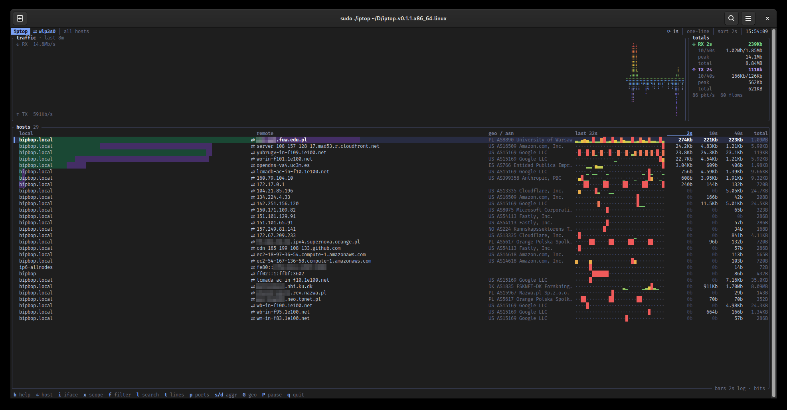

<div align="center">


A modern per-host network bandwidth monitor for the terminal.<br>
What btop is to top, iptop aims to be to iftop.

</div>

---

iptop shows which hosts your machine is talking to, how much traffic each one carries, and where
they are (GeoIP and ASN). It keeps iftop's key bindings and adds braille graphs, sparklines,
filters that apply to past traffic as well as new, an interface picker, and a per-host panel that
runs ping and traceroute.



## Features

- **Rust, no libpcap.** It reads packets from a raw Linux `AF_PACKET` socket. The kernel tells
  us whether each packet was sent or received, which works on `any`, `tun` and `wg` interfaces too.
- **iftop keys**: `n N s d S D p t 1 2 3 < > o b B L T P l f j k q` behave as you expect.
  One line per host pair is the default, so you don't need to press `t` every time.
- **btop-style display**: a mirrored braille RX/TX graph, gradient sparklines per host,
  bars that show the RX/TX split, and one time-scale knob (`+`/`-`) that sets the update rate,
  the averaging windows and the graph's span together.
- **A table you can read while it moves**: rows hold still while you scroll or click; the cursor
  stays on its row number (top mode) or follows a host wherever it ranks (`space`). Sort by any
  column (click its header), or by sent, received, total, flows, IP, ASN or country (`O`).
- **GeoIP + ASN** from MaxMind `.mmdb` files (GeoLite2 City/ASN, or ones patched with your own networks).
- **World map** (`m`): a pixelated map where every located host glows with its traffic, beside the
  graph or big. The selected host blinks.
- **Themes** (`c`, `--theme`): tokyo-night (default), dracula, nord, gruvbox, catppuccin,
  solarized-light, mono, and tty for terminals with only 16 colours.
- **Host panel** (Enter or click): live ping with a loss graph, a traceroute where every hop
  gets geo and ASN, the host's traffic graph, and its individual flows.
- **Filters that are applied to history:** a BPF-ish filter language with GeoIP terms
  (`f`; `asn 15169`, `cc PL`, `org google`), one-key hide/only for a host (`e` / `E`), a quick screen
  search (`/`), and an *external only* scope (`x`). Change them and the whole view, graph
  included, updates immediately.
- **Interface picker** (`i`, or `[` / `]`) with live rates per interface; scrollable, clickable.
- **Mouse support:** wheel to scroll, click to select, click again for the host panel.
- **Config file** (`~/.config/iptop/config`) for the options you always pass.

## Install

```sh
curl -fsSL https://raw.githubusercontent.com/Michuu/iptop/main/install.sh | sh
```

The script picks the right binary for your CPU, verifies it against the release's `SHA256SUMS`
and installs it to `/usr/local/bin` (using `sudo` if needed). It works with `wget` too:
`wget -qO- https://raw.githubusercontent.com/Michuu/iptop/main/install.sh | sh`.
Options: `IPTOP_VERSION=v0.1.3` (a specific version), `IPTOP_PREFIX=~/.local/bin` (another directory),
`IPTOP_SETCAP=1` (allow running without `sudo`; this lets every local user capture traffic).

## Download

Or download by hand. Each [release](https://github.com/Michuu/iptop/releases) has static Linux
binaries (musl, no dependencies):

| file | for |
|---|---|
| `iptop-vX.Y.Z-x86_64-linux.tar.gz` | PCs and servers, Intel or AMD |
| `iptop-vX.Y.Z-aarch64-linux.tar.gz` | Raspberry Pi 4 / 5 with a 64-bit OS, other ARM64 boards |
| `iptop-vX.Y.Z-armv7-linux.tar.gz` | Raspberry Pi 2 / 3 / 4 with a 32-bit OS |
| `iptop-vX.Y.Z-armv6-linux.tar.gz` | Raspberry Pi Zero / Zero W / 1 |
| `iptop-vX.Y.Z-riscv64-linux.tar.gz` | 64-bit RISC-V boards |

On a Pi, `uname -m` tells you which one you need: `aarch64`, `armv7l` or `armv6l`.

```sh
tar xzf iptop-v0.1.3-x86_64-linux.tar.gz
sudo install -m755 iptop-v0.1.3-x86_64-linux/iptop /usr/local/bin/
```

## Build from source

```sh
cargo build --release
sudo install -m755 target/release/iptop /usr/local/bin/
sudo setcap cap_net_raw,cap_net_admin=eip /usr/local/bin/iptop   # optional: run without sudo
```

When iptop runs as root, traceroute sends ICMP probes, which get through more firewalls.
Otherwise it falls back to UDP `traceroute` or `tracepath`.

## Nix / NixOS

```sh
sudo nix run .        # from a checkout; also: nix build, nix develop
```

On NixOS, import the flake's module to get a capability wrapper at
`/run/wrappers/bin/iptop`, so it runs without sudo:

```nix
{
  inputs.iptop.url = "github:Michuu/iptop";
  # in your nixosSystem modules:
  #   iptop.nixosModules.default
  #   { programs.iptop.enable = true; }
}
```

## Usage

```sh
sudo iptop                          # default-route interface
sudo iptop -i any -x                # every interface, external peers only
sudo iptop -x -I 10.0.0.0/8 -I 198.51.100.7   # hide traffic between your own networks/hosts
sudo iptop -f 'tcp and not (port 22 or port 443)'
sudo iptop -P --lines two           # ports + classic iftop two-line view
sudo iptop --scale slow -o total    # update every 5 s, sort by total bytes
```

| option | |
|---|---|
| `-i IFACE` | interface (`any` = all) |
| `-n` / `-N` | no DNS / no port names |
| `-p` | promiscuous mode |
| `-P` | show ports |
| `-b` / `-B` | no bars / show bytes instead of bits |
| `-F CIDR` | local network (for the direction of promiscuous traffic) |
| `-f EXPR` | flow filter (see below) |
| `-x` | external only |
| `-I CIDR` | extra networks/hosts to treat as internal (repeatable) |
| `-o KEY` / `-r` | sort by `1` `2` `3` (rate window), `sent` `recv` `total` `flows` `source` `destination` `ip` `asn` `country` / reversed |
| `--lines one\|two\|sent\|recv` | line display |
| `--scale S` | time scale: `fast` (default) `normal` `slow` `slower`, see below |
| `-u MS` / `-w A,B,C` | custom update interval / averaging windows (override `--scale`) |
| `--geoip PATH` | `.mmdb` file or directory |
| `--geo-format FMT` | geo column: `short` `org` `asn` `place` `full` `off` |
| `--theme NAME` | colour theme (see Features) |
| `--config PATH` / `--no-config` | use another config file / ignore it |

### Config file

Options you always use can go in `~/.config/iptop/config` (under `sudo`, the invoking user's
file is used). Each line is one option, as on the command line but without the dashes;
anything given on the command line wins, and repeatable options (`-I`, `-F`) add up.

```ini
# external peers only; our own networks count as internal
external
internal-net = 192.168.10.0/24
internal-net = 10.0.0.0/8
internal-net = 198.51.100.7
geo-format = full
theme = nord
filter = not port 22          # the value is the rest of the line
```

## Keys

| iftop classics | | iptop extras | |
|---|---|---|---|
| `n` / `N` | DNS / port names | `⏎` / click | **host panel**: geo, ASN, ping, traceroute, flows; `tab`/`l` switches remote ↔ local host |
| | | `O` / `R` / click header | **sort menu** / reverse / sort by that column (again: reverse) |
| | | `space` | follow the selected host as it moves / stay on the row number |
| `s` / `d` | hide local / remote host | `i`, `[` `]` | interface picker / prev / next |
| `S` `D` `p` | local / remote / all ports | `x` | scope: all → external → internal |
| `t` | two-line / one-line / sent / recv | `e` / `E` | filter out this host / only this host |
| `1 2 3 < >` | sort by window / src / dst (again: reverse) | `G` | geo format, table + traceroute (or off) |
| `o` | freeze order | `g` | traffic graph |
| `b` / `B` | bars / bar window | `u` | bits ↔ bytes |
| `L` | log / linear bars | `r` | reset stats |
| `T` | cumulative totals | `+` / `-` | time scale (below) |
| | | `m` / `c` | world map (off / beside graph / big) / colour theme |
| `P` | pause | `j k ↑ ↓ PgUp PgDn End` | move the cursor; `Home` back to the top |
| `l` or `/` | screen search | | |
| `f` | edit filter | `F` | clear filter + search |
| `q` | quit | `y` / `Y` | copy IP / hostname (OSC 52, wl-copy, xclip) |
| | | `h` / `?` | help |

### Scrolling, following and the time scale

The cursor normally stays on its row number while hosts move past it, so with the cursor at the
top you always see the busiest hosts. Scrolling or clicking holds the row order for 5 seconds
(`held` in the header) so nothing jumps under the pointer; `o` freezes it for good. Press `space`
to follow the selected host instead: the cursor sticks to it as it climbs or drops (`FOLLOW`).
The host panel follows its host the same way while it is open.

`+` / `-` change the time scale. The update interval always equals the shortest averaging window,
so every update shows a complete, fresh average and no traffic falls between updates; the graph
draws one sample per update, so slower scales show a longer history.

| scale | updates every | averages | graph covers |
|---|---|---|---|
| `fast` (default) | 1 s | 1 / 5 / 20 s | up to 15 min |
| `normal` (iftop's) | 2 s | 2 / 10 / 40 s | up to 30 min |
| `slow` | 5 s | 5 / 30 / 120 s | up to 1 h |
| `slower` | 10 s | 10 / 60 / 300 s | up to 1 h |

### Filter language

```
host|net CIDR          either side          src|dst [host|net] CIDR   local / remote side
port N                 either side          src port N, dst port N
tcp udp icmp sctp gre esp   proto N   ip   ip6
external               has a non-internal end      internal    both ends internal
asn N   cc XX   org "TEXT"   GeoIP of the remote peer (src asn … for the local side)
not ! and && or || ( )                      juxtaposition means "and"
```

For example: `tcp and not (port 22 or port 443)`, `dst net 8.8.0.0/16 or udp`, `external and port 53`,
`external and not cc PL`, `asn 15169 or org "cloudflare"`. `org` matches part of the AS organisation, ignoring case.

**Internal** means RFC1918, CGNAT, loopback, link-local, ULA, broadcast and multicast, plus anything you
pass with `-I`.

## GeoIP

iptop reads any MaxMind-format database: GeoLite2 City/Country/ASN, DB-IP lite, or your own
patched copy. It merges what it finds, so City + ASN gives `Warsaw, Poland (PL) · AS8501 …` in the
host panel, along with the network block (`142.250.0.0/15`). `G` cycles the table column and the host panel's traceroute through these formats:

| format | example |
|---|---|
| `short` (default) | `PL AS8501 PSNC` |
| `org` | `PL PSNC` |
| `asn` | `PL AS8501` |
| `place` | `Warsaw, PL` |
| `full` | `Warsaw, PL · AS8501 PSNC` |
| `off` | column hidden |

Search order: `--geoip PATH` → `~/geoip-*/mmdb/` → `~/geoip-*/` (also under `$SUDO_USER`'s home) →
`~/.local/share/iptop/` → `/usr/share/GeoIP` → `/var/lib/GeoIP` → `/usr/local/share/GeoIP`.

## Hacking

```
src/capture.rs   AF_PACKET socket + IPv4/IPv6 parsing
src/stats.rs     per-flow ring buffers of 1-second slots
src/filter.rs    scope + filter language
src/app.rs       state, aggregation into rows, keys
src/ui.rs        ratatui rendering (braille graphs, table, popups, host panel)
src/probe.rs     ping / traceroute runners
src/geo.rs       mmdb lookups
src/resolver.rs  async reverse DNS
```

`cargo test` runs the parser, filter and probe tests. `scripts/release.sh` builds the static
release tarballs into `dist/` (it needs `cargo-zigbuild` and `zig`).

## Credits

Inspired by [iftop](https://pdw.ex-parrot.com/iftop/) by Paul Warren and Chris Lightfoot, and
[btop](https://github.com/aristocratos/btop). The world map's land outline is rasterized from
[Natural Earth](https://www.naturalearthdata.com/) (public domain); host positions need a City database.

License: GPL-2.0-or-later.
